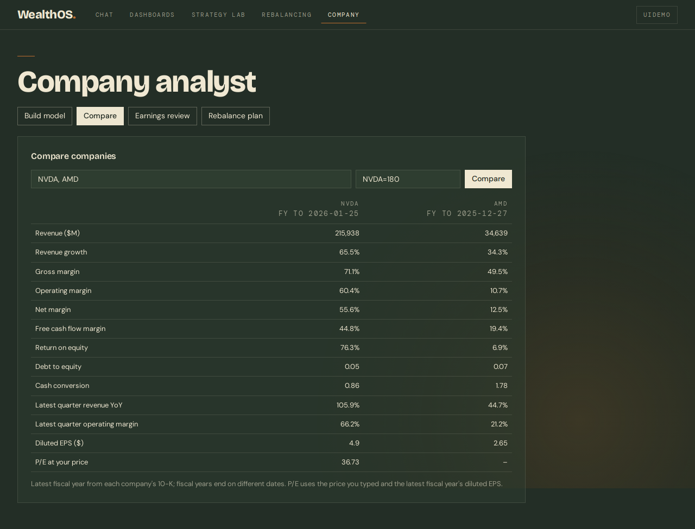
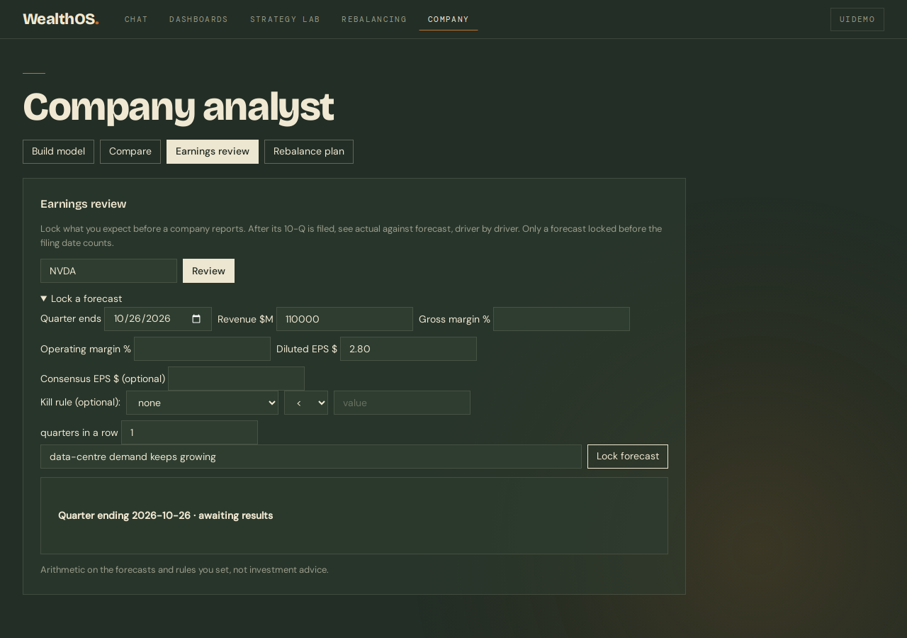
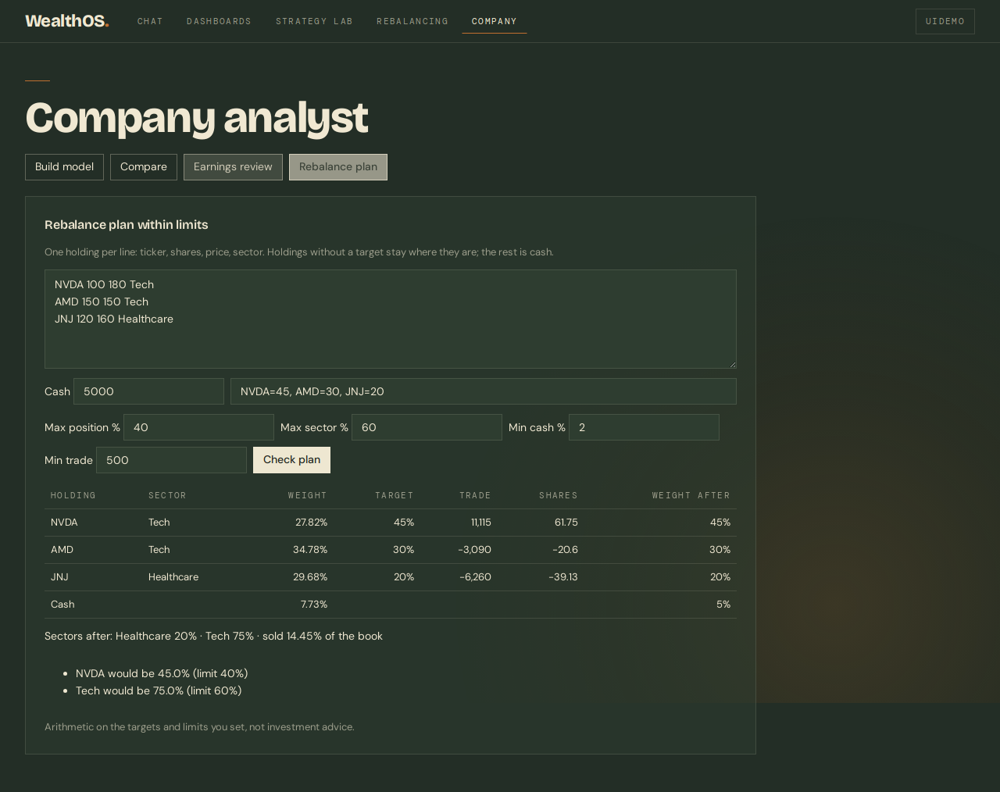
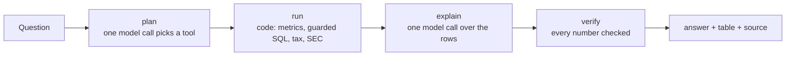

<p align="center">
  <picture>
    <source media="(prefers-color-scheme: dark)" srcset="docs/assets/logo-dark.svg">
    
  </picture>
</p>

<p align="center">
  <b>An AI analyst for your own money that checks every number it says.</b><br>
  Indian bank, broker and mutual-fund statements in, plain-English answers out,<br>
  plus a US company-analyst mode built from SEC filings.
</p>

<p align="center">
  <a href="https://github.com/AmanDataGuy/WealthOS/actions/workflows/ci.yml"></a>
  
  
  <a href="LICENSE"></a>
</p>

<p align="center">
  <a href="TECHNICAL_REPORT.md">Eval report</a> ·
  <a href="docs/architecture.md">Architecture</a> ·
  <a href="docs/company_mode.md">Company mode</a> ·
  <a href="docs/mcp.md">MCP server</a>
</p>

<br>

| Result                                          |       WealthOS |        Baseline |
| :---------------------------------------------- | -------------: | --------------: |
| Right numbers, 25 number questions of 34        |        **96%** | 72%<sup>1</sup> |
| Right kind of answer (answer, ask back, refuse) |       **100%** |             85% |
| SQL attacks blocked                             |   **53 of 53** |               – |
| Normal queries wrongly blocked                  |        0 of 16 |               – |
| Wrong numbers the number check lets through     |       **1.5%** |               – |
| Company accounting checks that tie out          | **115 of 117** |               – |

<sup>1</sup> The same model writing SQL directly. Model `openai/gpt-oss-120b` on Groq and on OpenRouter, measured
13 and 14 Nov 2026 on synthetic data, 2.9 s median per question. Method and every run: [technical report](TECHNICAL_REPORT.md).

<!-- src:
  right numbers: backend/evals/results.json#summary.value_accuracy_pct, backend/evals/results_openrouter.json#summary.value_accuracy_pct
  baseline: backend/evals/results_baseline.json#summary.value_accuracy_pct, #summary.plan_match_pct
  right kind: backend/evals/results.json#summary.plan_match_pct
  SQL: backend/evals/results_sets.json#sql.block_rate_pct, #sql.false_block_rate_pct
  number check: backend/evals/results_sets.json#numbers.false_accept_pct
  company: backend/evals/company_tieouts.json#pass_rates
-->

<table>
  <tr>
    <td width="33%"></td>
    <td width="33%"></td>
    <td width="33%"></td>
  </tr>
  <tr>
    <td align="center">Compare companies</td>
    <td align="center">Earnings review</td>
    <td align="center">Rebalance plan within limits</td>
  </tr>
</table>

## What it does

- **Ask your money anything.** Upload bank and card statements (CSV, Excel, HDFC, ICICI and SBI PDFs), broker
  tradebooks, holdings and CAS files, then ask *"How much did I spend on food this FY?"* or *"Old or new tax regime
  for me?"*. New users can load a synthetic year with one click. ([ingest](docs/ingest.md))
- **Every number is checked.** The model plans and explains; code computes. If a sentence has a number that is not
  in the results, the user sees the table instead. ([assistant graph](docs/agent_graph.md))
- **Company analyst.** Type a US ticker to get five years of statements, ratios and a DCF as an Excel model where
  every figure names its SEC filing. Compare 2 to 6 companies, review each quarter against a forecast you locked
  before the results, and check a rebalance plan against your own limits. ([company mode](docs/company_mode.md))
- Dashboards you build by hand or by asking, with Excel export and your own Excel templates.
- A strategy lab that backtests a rule with Indian charges and a deflated Sharpe ratio, and drift from your target mix.
- A read-only MCP server for metrics, tax, drift and backtests. ([MCP](docs/mcp.md))
- No buy, sell or hold advice. WealthOS is not SEBI-registered.

## How it works



1. A vague question ("what's my return?") is asked back in code, before any model call.
2. The planner picks one of 15 plan kinds. Code runs it on a locked, read-only DuckDB over your files.
3. The explainer sees at most 40 rows. `verify` matches every number in its text to the rows, or shows the table.

The main design choice is a metrics layer of 18 defined measures instead of free text-to-SQL. With the same model
and questions it gets 96% of numbers right against 72%. More in [architecture](docs/architecture.md).

## Quickstart

```bash
git clone https://github.com/AmanDataGuy/WealthOS && cd WealthOS
cp .env.example .env              # set GROQ_API_KEY and WEALTHOS_JWT_SECRET (32+ bytes)
docker compose up -d --build      # web, API, price worker, Postgres
# open http://localhost:8080, sign up, then "Load sample data"
```

For local development on Python 3.11: `pip install -r backend/requirements-dev.txt`, then `bash start.sh`
(web on :5173). Tests need no keys: `cd backend && WEALTHOS_ENV=test pytest -q`.

## Evaluation

| Eval                    |          Size |                Result | Compared with                 |
| :---------------------- | ------------: | --------------------: | :---------------------------- |
| Golden set, numbers     |  25 questions |               **96%** | 72% text-to-SQL, 44% local 8B |
| Golden set, answer kind |  34 questions |              **100%** | 85% text-to-SQL               |
| SQL guard               |    69 queries |   **53 / 53** blocked | 0 / 16 normal ones blocked    |
| Number check            | 179 sentences | **1.5%** false accept | 0% false reject               |
| PII redaction           |    55 strings |      **84.6%** recall | misses names in narrations    |
| Company tie-outs        |   5 companies |         **115 / 117** | 573 / 573 formulas recompute  |

Golden-set answers are replayed in CI with no keys, and the labelled sets fail the build if any rate gets worse.
To reproduce live: `cd backend && python evals/run.py`. Every run and failure is in the
[eval results](docs/eval/README.md) and the [error analysis](docs/eval/ERROR_ANALYSIS.md).

<!-- src: backend/evals/results.json, results_openrouter.json, results_baseline.json, results_local_qwen3_8b.json,
     results_sets.json (sql, numbers, pii), company_tieouts.json, company_quarters.json#totals -->

## Limitations

- Not deployed yet. It runs locally or with Docker; an AWS deployment is planned.
- Every eval set is synthetic, and the PDF reader has not seen a real bank statement.
- 34 golden questions is a small set: one question moves the score by about 3 points.
- Regex PII redaction misses names inside payment narrations.
- Company mode covers US filers only, refuses banks and insurers, and takes the share price as an input.

## Docs

| Topic                                      | Where                                                                         |
| :----------------------------------------- | :---------------------------------------------------------------------------- |
| Architecture, parts, repo layout, settings | [docs/architecture.md](docs/architecture.md)                                  |
| The assistant graph, checkpoints, tracing  | [docs/agent_graph.md](docs/agent_graph.md)                                    |
| File ingest and column mapping             | [docs/ingest.md](docs/ingest.md)                                              |
| Company mode and the earnings loop         | [docs/company_mode.md](docs/company_mode.md)                                  |
| Evals, result files, error analysis        | [docs/eval/](docs/eval/README.md), [TECHNICAL_REPORT.md](TECHNICAL_REPORT.md) |
| MCP server setup                           | [docs/mcp.md](docs/mcp.md)                                                    |
| Security model                             | [SECURITY.md](SECURITY.md)                                                    |

**Stack:** Python 3.11, FastAPI, LangGraph, DuckDB, Postgres, React and TypeScript, Groq and OpenRouter, openpyxl,
MCP, Docker. **License:** MIT.
