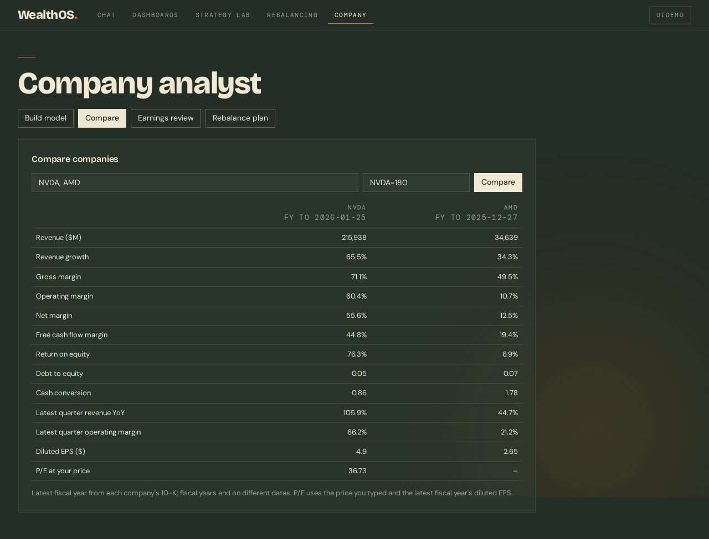
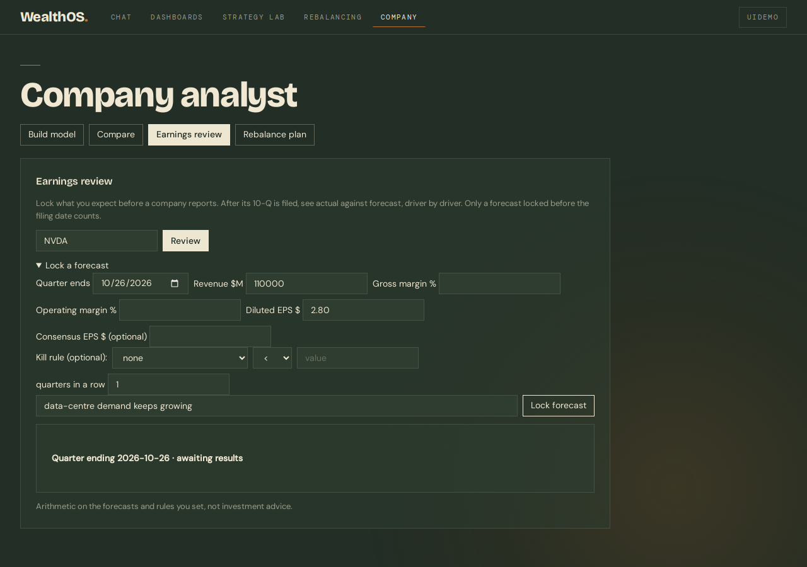
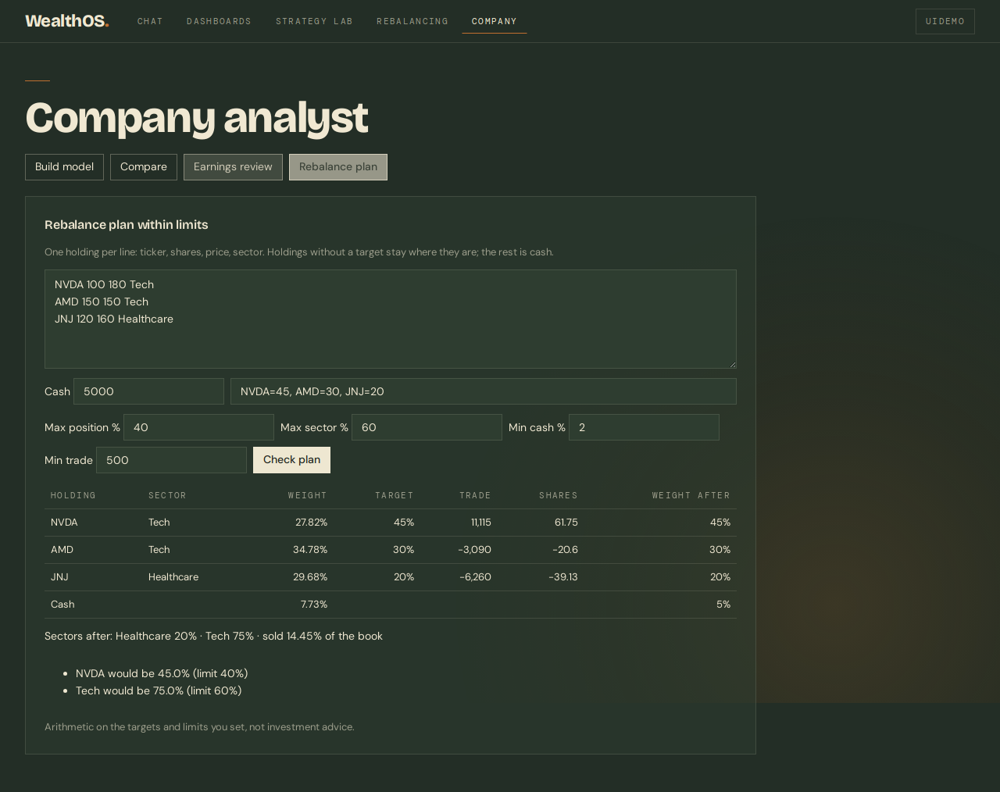
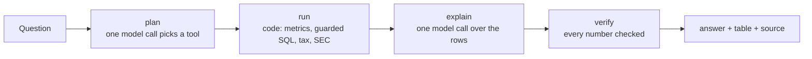

<p align="center">
  <picture>
    <source media="(prefers-color-scheme: dark)" srcset="docs/assets/logo-dark.svg">
    
  </picture>
</p>

<p align="center">
  <b>An AI analyst for your own money that checks every number it says.</b><br>
  Indian bank, broker and mutual-fund statements in, plain-English answers out,<br>
  plus a US company-analyst mode built from SEC filings.
</p>

<p align="center">
  <a href="https://github.com/AmanDataGuy/WealthOS/actions/workflows/ci.yml"></a>
  
  
  <a href="LICENSE"></a>
</p>

<p align="center">
  <a href="TECHNICAL_REPORT.md">Eval report</a> ·
  <a href="docs/architecture.md">Architecture</a> ·
  <a href="docs/company_mode.md">Company mode</a> ·
  <a href="docs/mcp.md">MCP server</a>
</p>

<br>

| Result                                          |       WealthOS |        Baseline |
| :---------------------------------------------- | -------------: | --------------: |
| Right numbers, 25 number questions of 34        | **96 to 100%** | 72%<sup>1</sup> |
| Right kind of answer (answer, ask back, refuse) |       **100%** |             85% |
| SQL attacks blocked                             |   **53 of 53** |               – |
| Normal queries wrongly blocked                  |        0 of 16 |               – |
| Wrong numbers the number check lets through     |       **1.5%** |               – |
| Company accounting checks that tie out          | **115 of 117** |               – |

<sup>1</sup> The same model writing SQL directly. Model `openai/gpt-oss-120b` on Groq and on OpenRouter, measured
13 and 20 Nov 2026 on synthetic data (96% on OpenRouter, 100% on Groq: one question apart), about 3 s median per question. Method and every run: [technical report](TECHNICAL_REPORT.md).

<!-- src:
  right numbers: backend/evals/results.json#summary.value_accuracy_pct, backend/evals/results_openrouter.json#summary.value_accuracy_pct
  baseline: backend/evals/results_baseline.json#summary.value_accuracy_pct, #summary.plan_match_pct
  right kind: backend/evals/results.json#summary.plan_match_pct
  SQL: backend/evals/results_sets.json#sql.block_rate_pct, #sql.false_block_rate_pct
  number check: backend/evals/results_sets.json#numbers.false_accept_pct
  company: backend/evals/company_tieouts.json#pass_rates
-->

<table>
  <tr>
    <td width="33%"></td>
    <td width="33%"></td>
    <td width="33%"></td>
  </tr>
  <tr>
    <td align="center">Compare companies</td>
    <td align="center">Earnings review</td>
    <td align="center">Rebalance plan within limits</td>
  </tr>
</table>

## What it does

- **Ask your money anything.** Upload bank and card statements (CSV, Excel, HDFC, ICICI and SBI PDFs), broker
  tradebooks, holdings and CAS files, then ask *"How much did I spend on Swiggy this FY?"* or *"Old or new tax regime
  for me?"*. New users can load a synthetic year with one click. ([ingest](docs/ingest.md))
- **Every number is checked.** The model plans and explains; code computes. If a sentence has a number that is not
  in the results, the user sees the table instead. ([assistant graph](docs/agent_graph.md))
- **Company analyst.** Type a US ticker to get five years of statements, ratios and a DCF as an Excel model where
  every figure names its SEC filing. Compare 2 to 6 companies (also over the last four quarters, with fixed-rule
  warning flags such as falling revenue or profit not backed by cash), review each quarter against a forecast you locked
  before the results, and check a rebalance plan against your own limits. ([company mode](docs/company_mode.md))
- **Ask your filings.** Upload a 10-K or annual report PDF and ask about risks, segments, lawsuits or notes. Answers
  cite pages, every number must appear in a passage the answer cites, and a question the filing does not answer
  gets "Not found in the filings." Search is BM25 over section-aware chunks, with hybrid search on pgvector and a
  re-ranker as a setting. ([results](docs/rag/RESULTS.md))
- Dashboards you build by hand or by asking, with Excel export and your own Excel templates.
- A strategy lab that backtests a rule with Indian charges and a deflated Sharpe ratio, warns when the profit does not
  survive doubled charges or the last 30% of the period, and refuses uploaded strategies that read future prices.
- Drift from your target mix, with how concentrated the holdings are (effective number of holdings, top five's share),
  and a risk report on today's holdings over past prices: volatility, worst drawdown and month, one-day VaR, each
  holding's share of risk and the most correlated pairs. Sector shares appear only where NSE data is switched on
  (the Nifty 500 industry list is for personal use), so never on a production server.
- A read-only MCP server for metrics, tax, drift and backtests. ([MCP](docs/mcp.md))
- No buy, sell or hold advice. WealthOS is not SEBI-registered.

## How it works



1. A vague question ("what's my return?") is asked back in code, before any model call.
2. The planner picks one of 15 plan kinds. Code runs it on a locked, read-only DuckDB over your files.
3. The explainer sees at most 40 rows. `verify` matches every number in its text to the rows, or shows the table.

The main design choice is a metrics layer of 18 defined measures instead of free text-to-SQL. With the same model
and questions it gets 96 to 100% of numbers right against 72%. More in [architecture](docs/architecture.md).

## Quickstart

```bash
git clone https://github.com/AmanDataGuy/WealthOS && cd WealthOS
cp .env.example .env              # set GROQ_API_KEY and WEALTHOS_JWT_SECRET (32+ bytes)
docker compose up -d --build      # web, API, price worker, Postgres
# open http://localhost:8080: a guest account with sample data opens, no sign-up
```

For local development on Python 3.11: `pip install -r backend/requirements-dev.txt`, then `bash start.sh`
(web on :5173). Tests need no keys: `cd backend && WEALTHOS_ENV=test pytest -q`.

## Evaluation

| Eval                    |          Size |                Result | Compared with                 |
| :---------------------- | ------------: | --------------------: | :---------------------------- |
| Golden set, numbers     |  25 questions |        **96 to 100%** | 72% text-to-SQL, 44% local 8B |
| Golden set, answer kind |  34 questions |              **100%** | 85% text-to-SQL               |
| SQL guard               |    69 queries |   **53 / 53** blocked | 0 / 16 normal ones blocked    |
| Number check            | 179 sentences | **1.5%** false accept | 0% false reject               |
| PII redaction           |    55 strings |      **84.6%** recall | misses names in narrations    |
| Company tie-outs        |   5 companies |         **115 / 117** | 573 / 573 formulas recompute  |
| Filing search, recall@5 |  66 questions |             **1.000** | 0.894 page BM25, 0.939 hybrid |
| Paraphrased filing qs   |  39 questions | **0.769** hybrid + re-rank | 0.615 BM25                |
| Filing answers          |  81 questions |  **15 / 15** unanswerable refused | 0.967 Ragas faithfulness (31 judged) |
| Production check        |     12 checks |  **12 / 12** pass | 250 concurrent requests, 0 errors |

Golden-set answers are replayed in CI with no keys, and the labelled sets fail the build if any rate gets worse.
To reproduce live: `cd backend && WEALTHOS_ENV=dev python evals/run.py`. Every run and failure is in the
[eval results](docs/eval/README.md) and the [error analysis](docs/eval/ERROR_ANALYSIS.md).

<!-- src: backend/evals/results.json, results_openrouter.json, results_baseline.json, results_local_qwen3_8b.json,
     results_sets.json (sql, numbers, pii), company_tieouts.json, company_quarters.json#totals,
     results_rag.json#arms.bm25/structure.recall_at_5, #arms.pages_bm25_before.recall_at_5, #arms.hybrid/structure.recall_at_5,
     results_rag_hard.json#arms.hybrid+rerank/fixed.recall_at_5, #arms.bm25/structure.recall_at_5,
     results_rag_answers.json#summary.bm25/structure.refused_unanswerable, #summary.bm25/structure.ragas_faithfulness,
     results_production_check.json#all_pass, #checks.6_load -->

## Status

Built and measured (every number above has a committed result file):
- The money assistant, company mode and the MCP server.
- Filing Q&A over chunked 10-Ks: BM25, pgvector hybrid search and re-ranking compared on 66 easy and 39 hard
  questions; pgvector returns the same rankings as the in-memory eval; live answers scored for accuracy, refusals
  and Ragas faithfulness.
- CI replays the recorded golden answers, gates the labelled sets, and gates filing recall@5 on the real 10-Ks.

Open:
- Not deployed; an AWS deployment is designed but not built.
- The open review findings in [SECURITY.md](SECURITY.md) (strategy sandbox, Excel cell escaping, the cost cap without
  a database, worker and proxy settings, account-delete order).
- Ragas judged about half the easy filing answers before the eval's OpenRouter credit ran out. The hard-set
  answer run on Groq's free tier stopped at its daily limit after 45 of 51 questions; the last 6 near-miss questions
  and Ragas for that set are not measured.
- The filing number check does not apply a table's units, so "13,308 million" read from an "(in millions)" table is
  rejected.

## Limitations

- Not deployed yet. It runs locally or with Docker; an AWS deployment is planned.
- The money eval sets are synthetic, and the PDF reader has not seen a real bank statement. The company tie-outs
  and the filing search set use real SEC filings.
- 34 golden questions is a small set: one question moves the score by about 3 points.
- Regex PII redaction misses names inside payment narrations.
- Company mode covers US filers only, refuses banks and insurers, and takes the share price as an input.
- Filing evals cover two 10-Ks. Re-ranking runs on the CPU at 6 to 8 s per question, so it is off by default.

## Docs

| Topic                                      | Where                                                                         |
| :----------------------------------------- | :---------------------------------------------------------------------------- |
| Architecture, parts, repo layout, settings | [docs/architecture.md](docs/architecture.md)                                  |
| The assistant graph, checkpoints, tracing  | [docs/agent_graph.md](docs/agent_graph.md)                                    |
| File ingest and column mapping             | [docs/ingest.md](docs/ingest.md)                                              |
| Company mode and the earnings loop         | [docs/company_mode.md](docs/company_mode.md)                                  |
| Evals, result files, error analysis        | [docs/eval/](docs/eval/README.md), [TECHNICAL_REPORT.md](TECHNICAL_REPORT.md) |
| Filing search: chunking, hybrid, re-ranking | [docs/rag/RESULTS.md](docs/rag/RESULTS.md)                                    |
| MCP server setup                           | [docs/mcp.md](docs/mcp.md)                                                    |
| Security model                             | [SECURITY.md](SECURITY.md)                                                    |

**Stack:** Python 3.11, FastAPI, LangGraph, DuckDB, Postgres with pgvector, fastembed, React and TypeScript, Groq and OpenRouter, openpyxl,
MCP, Docker. **License:** MIT.
