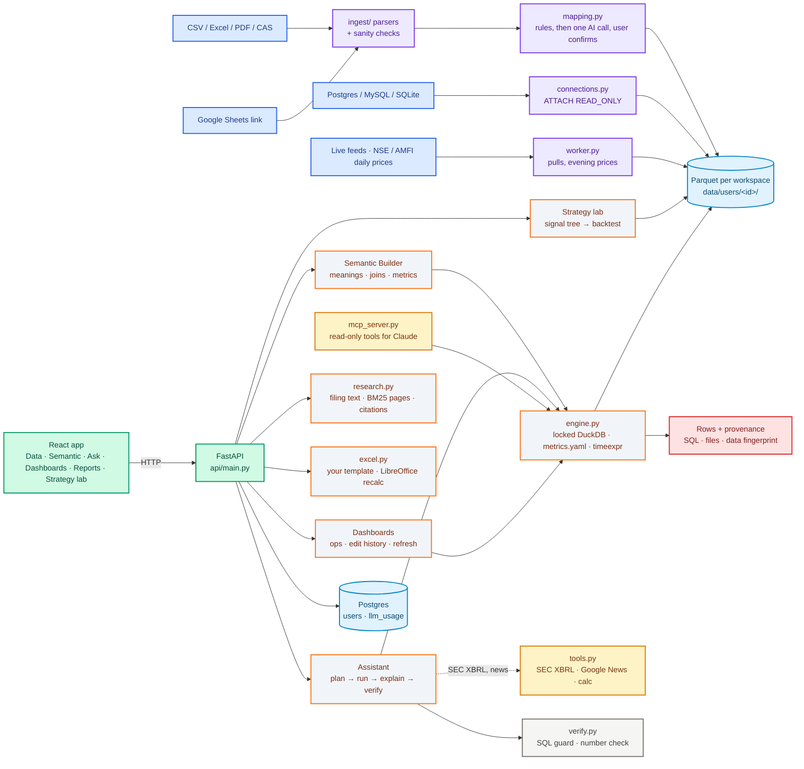

<div align="center">

# WealthOS

**Data to Decisions, for Finance Teams and Indian Investors**

[](https://python.org)
[](https://duckdb.org)
[](https://fastapi.tiangolo.com)
[](https://postgresql.org)
[](https://react.dev)
[](https://echarts.apache.org)

*Connect your data once, agree what the numbers mean, then ask, build and share dashboards everyone can trace back to the source.*

</div>

---

## What It Does

A finance lead connects the company's Postgres and a budget sheet. WealthOS copies the tables in read-only, suggests what each column means, and builds a Monthly MIS dashboard from a template: revenue, cost, margin, budget vs actual. She asks *"why did June's margin drop?"* and gets an answer whose every number links to the SQL and rows behind it.

An investor drops in a Zerodha tradebook, a CAS PDF and a bank statement. WealthOS reads them, asks him to confirm two columns it isn't sure about, and shows his portfolio, spending and FY capital gains (short vs long term, FIFO). He tests *"buy NIFTYBEES when the 50-day average crosses the 200-day"* against real Indian charges before risking a rupee.

The AI plans and explains. Code computes every number. No buy/sell advice, ever.

---

## Architecture



> The AI never writes a number the user sees. It picks a metric or writes one read-only SELECT; `verify.py` checks the SQL against the real schema, DuckDB runs it on a connection that can only read that user's folder, and every number in the written answer is matched against the returned rows. All Python code lives in `wealthos/`; the web API is `api/main.py` and the React app is `web/`.

---

<div align="center">

## Pipeline & Modules

| Module | Approach | Key Capability | Output |
|:---:|:---:|:---:|:---:|
| Ingest | Header matching + sanity checks, no AI | Zerodha/Groww tradebooks, bank statements (Indian number formats), holdings, daily prices, CAS PDFs, annual-report PDFs via `finx` | Clean tables with source file + row for every value |
| Mapping | Rules → one AI call → user confirms | Unknown layouts get a suggested mapping with confidence badges; confirmed layouts map themselves next time | Column map keyed by header fingerprint |
| Semantic Builder | Type/name rules + user edits | Column roles, table relationships, workspace metrics that are parsed, guarded and test-run before saving | `semantic.json` per workspace |
| Engine | DuckDB over Parquet, locked | Trusted metrics (spend, savings rate, FIFO gains, XIRR, portfolio value ...), Indian FY time expressions, month/year splits | Rows + provenance (SQL, files, data fingerprint) |
| Assistant | One fixed pipeline, two AI calls | Plans a metric or guarded SQL, explains from rows only, replaces any sentence with an unmatched number; clarify questions become remembered definitions; chats saved per workspace | Answer with Trusted / Exploratory badge |
| Dashboards | JSON spec edited only through ops | 9 templates, drag/resize editor, AI edit with preview, undo/redo, refresh with no AI, pin from chat, reports with a number-checked summary | Spec with edit history + report / PDF |
| Strategy Lab | Signal tree + vectorized daily engine | Next-day fills, NSE delivery/intraday charges, split guard, buy-and-hold benchmark, deflated Sharpe | Equity curve + run card |
| Research | finx page index + BM25, no vectors | Questions on uploaded 10-Ks and annual reports answered from up to 6 selected pages; every number must be on a cited page | Cited answer |
| Tax | Per-FY YAML rule tables | Old vs new regime, capital gains from your tradebook, 80C headroom, every rate checked on incometaxindia.gov.in | "Educational, verify with a CA" summary |

</div>

---

<div align="center">

## Data Sources & Connectors

| Connector | Formats | Data Source |
|:---:|:---:|:---:|
| File upload | CSV, XLSX, PDF | Bank / card statements, broker tradebooks, holdings, daily prices, CAS (with password), filings |
| Google Sheets | Share-by-link CSV export | Any sheet tab; OAuth for private sheets later |
| Database | Postgres, MySQL, SQLite | Tables copied in read-only as Parquet snapshots, refreshable; credentials Fernet-encrypted |
| SEC EDGAR | XBRL company facts | US company revenue, profit, cash flow with filing ids (`tools.py`) |
| News | Google News RSS | Recent headlines, quoted as data, never followed as instructions |
| Daily prices | NSE bhavcopy, mfapi.in (AMFI NAVs) | Free, no key; stocks/ETFs and mutual funds, refreshed every evening |
| Live feeds | Webhook push, https URL pull | Token-checked push, SSRF-guarded pull on a schedule, Parquet part files compacted after 20 |
| Snowflake / MongoDB *(planned)* | Arrow batches | Only when a real user asks |

**Every source lands as Parquet in a workspace.** Chats and dashboards only see their own workspace's tables, and the query connection never touches a live database.

</div>

---

<div align="center">

## Under the Hood

| Category | Stack | Detail |
|:---:|:---|:---|
| **Engine** | DuckDB 2.0 over Parquet | In-memory connection per request; external access, extension autoload and community extensions off; memory/thread limits; `lock_configuration` last; 10 s timeout |
| **SQL Guard** | DuckDB parser + sqlglot | Exactly one SELECT, no file/URL/settings functions, every table and column checked against the real schema, 5,000-row cap |
| **Number Check** | `verify.check_numbers` | Every number in a written answer must match a result (or a simple sum, difference, % change) within 0.5%; ₹ lakh/crore understood |
| **LLM** | Groq `openai/gpt-oss-120b` (free tier) + free OpenRouter fallback (`nemotron-3-ultra:free`) | One client, JSON answers validated with Pydantic plus one repair retry, daily cost cap, usage logged per user |
| **Metrics** | `metrics.yaml` + workspace metrics | Same definition everywhere: assistant, dashboards, exports |
| **Time** | `timeexpr.py` | `today`, `mtd`, `qtd`, `ytd`, `fy` (Apr-Mar), `last_fy`, `trailing_12m`, explicit ranges, Asia/Kolkata dates |
| **Mapping** | Rules → AI → confirm | PII masked before the AI sees sample values; the AI may only answer with standard column names |
| **Dashboards** | Spec + ops + edit history | Every edit is an op checked before saving and kept as a new edit; a stale screen can't overwrite newer work |
| **Refresh** | Parallel, no AI | Each tile re-runs its query; failed tiles show their own error; diff vs the last refresh |
| **Strategy** | pandas, vectorized | Decide at the close, fill at the next open; NSE STT, stamp duty, exchange and SEBI fees, GST; deflated Sharpe across your earlier tries |
| **Connections** | DuckDB postgres/mysql/sqlite extensions | Separate short-lived connection, READ_ONLY attach, password scrubbed from every error |
| **Extraction** | `finx` | PDF statements with verified/unverified badges per number; Indian grouping and lakh/crore units |
| **Excel Templates** | openpyxl + headless LibreOffice | Upload-time allowlist scan (no macros, OFFSET/INDIRECT, Tables), recalc with a throwaway profile, named output cells, errors reported |
| **Exports** | openpyxl / browser print | Excel with a provenance sheet (SQL, period, files, data fingerprint); text cells can't become formulas; PDF via print |
| **Frontend** | React 18 + Vite | react-grid-layout canvas, ECharts, dark theme with a blue-to-warm glow, serif headings; prints black on white |
| **Auth** | bcrypt + JWT | 7-day sessions; the API refuses to start without a 32+ byte secret; no default accounts; users can export or delete all their data |
| **Storage** | Parquet per user + Postgres | `data/users/<id>/` holds raw files, datasets, workspaces, dashboards, runs; Postgres holds users and the LLM cost log |
| **Outward MCP** | Read-only MCP server (`mcp_server.py`) | `list_workspaces`, `list_metrics`, `query_metric`, `explain_number` on your own data from Claude Desktop; token-checked |
| **Compliance** | Always on | No buy/sell/hold advice, no price targets, no return claims; "Educational analytics, not investment advice" on every answer |

</div>

---

<div align="center">

## Eval Results

**Measured on live outputs only.** `evals/run.py` asks 34 questions over 24 months of synthetic bank rows (one carrying a prompt injection), a Zerodha tradebook and a holdings export; every expected value is summed in plain Python, not by the engine, and must match within 0.5%. Live on Groq `gpt-oss-120b`: **value accuracy 100% (25/25)**, plan match 100%, advice questions refused 100%, 1.7 LLM calls per question (a fresh run with no recorded replies). The first run scored 88% and exposed five bugs, all fixed. CI replays the first 10 from recorded replies with no keys.

</div>

---

<div align="center">

## Quick Start

```bash
git clone https://github.com/AmanDataGuy/WealthOS
cd WealthOS
python -m venv venv && venv\Scripts\activate   # Windows
pip install -r requirements.txt
cp .env.example .env                           # fill in GROQ_API_KEY at least
# tests: pip install -r requirements-dev.txt && pytest
```

**Start Postgres (Docker Desktop must be running; only sign-in and the cost log use it). Or run everything, `docker compose up -d --build`, and open http://localhost:8080:**
```bash
docker compose up -d wealthos-db
```

**Check your setup (the API creates its two tables on first start):**
```bash
python scripts/verify_env.py
```

**Start the API and the web app:**
```powershell
.\start.ps1          # Windows; bash start.sh on macOS / Linux
```

Open **http://localhost:5173**. Sign up, or set `WEALTHOS_DEMO_SEED=1` to get one demo account (its random password is printed once in the API log).

**Add data (first time):**
Go to **Data** → upload a bank CSV or tradebook, paste a Google Sheet link, or connect a database. Then **Dashboards** → **From template**. Unrecognised files show "needs mapping"; confirm the columns once and the same layout maps itself next time.

**Required environment variables:**

| Variable | Purpose |
|---|---|
| `GROQ_API_KEY` | Primary LLM (required) |
| `OPENROUTER_API_KEY` | Fallback LLM provider (free model by default): recommended |
| `WEALTHOS_DB_URL` | Postgres for sign-in and the LLM cost log |
| `WEALTHOS_JWT_SECRET` | Signs session tokens; required, 32+ bytes |
| `WEALTHOS_ENV` | `dev`, `test` or `production` (unset = production) |
| `WEALTHOS_FERNET_KEY` | Encrypts saved database connection strings |
| `SEC_USER_AGENT` | Name + email SEC asks every client to send |
| `WEALTHOS_MAX_DAILY_COST_USD` | Daily LLM spend cap for the whole server (default 5) |
| `WEALTHOS_MAX_DAILY_COST_USD_USER` | Daily LLM spend cap per user (default 0.50) |
| `WEALTHOS_TRUSTED_PROXIES` | Proxy IPs whose X-Forwarded-For is trusted for rate limits |
| `WEALTHOS_RISK_FREE_RATE` | Sharpe ratio risk-free rate (default 6.5%) |
| `LLM_MODEL` / `LLM_FALLBACK_MODEL` | Model overrides |
| `LIBREOFFICE_PATH` | Only if LibreOffice is not in the default place (Excel templates) |
| `ALLOWED_ORIGINS` | Browser origins allowed to call the API |

See `.env.example` for the full list.

---

## Demo

**Walkthrough video:** to be recorded; it follows the script below.

The app has four tabs: **Data** to bring files and databases in, **Ask** to chat with a workspace, **Dashboards** for the editor and templates, and **Strategy lab**.

Each answer shows its badge, the table behind it, and *How this was computed*. Dashboard tiles show *Trusted* or *Exploratory* in the corner.

**Suggested data for a live walkthrough:**

| Audience | Data | What it shows |
|--------|---------|----------|
| Retail | Zerodha tradebook, CAS PDF, bank CSV, daily prices | Portfolio, spending, FY capital gains, strategy lab |
| Business | A SQLite/Postgres sales DB, a budget Google Sheet | Sales performance, MIS / P&L, budget vs actual |

**3-minute script:**

1. **Data** → upload a messy tradebook, a CAS PDF (with password) and a bank CSV → confirm the two columns marked amber
2. **Dashboards** → **From template** → Portfolio → change the period to `last_fy` → **Refresh** (no AI involved)
3. **Ask** → *"What were my realized gains this FY, short vs long term?"* → Trusted badge → *How this was computed* (SQL, files) → **Add to dashboard**
4. **Strategy lab** → *"Buy NIFTYBEES when the 50-day average crosses above the 200-day, sell when it crosses back"* → read the rule → run → equity curve vs buy-and-hold, charges, deflated Sharpe, label
5. Upload a 10-K PDF → **Ask** *"What are the main risks?"* → answer with page citations, each number checked against the cited page
6. **`http://<host>:8000/docs`** → every route: workspaces, connections, semantic, dashboards, templates, strategy, sources, feeds, research, query, assistant

Any CSV works: unknown layouts go through mapping once, then behave like built-in ones.

</div>
