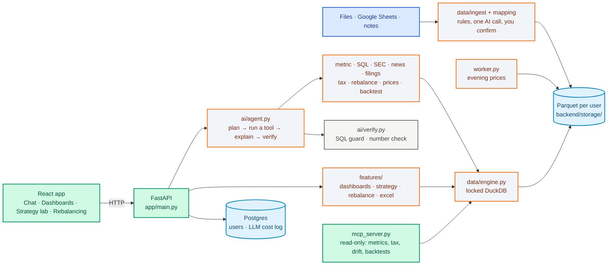

<div align="center">

# WealthOS

**Ask your own financial data anything, with every number traced to its source**

[](https://python.org)
[](https://duckdb.org)
[](https://fastapi.tiangolo.com)
[](https://postgresql.org)
[](https://react.dev)

</div>

---

## What It Does

The home page is a chat. Under the message box, **+ Query your own data** takes bank and card statements, broker
tradebooks, holdings, CAS PDFs, daily prices, annual reports, Google Sheets and plain notes. Then ask:
*"How much did I spend on food this FY?"*, *"Old or new tax regime for me?"*, *"Is my portfolio off target?"*,
*"Backtest INFY when RSI is below 30, sell above 70"*. Chats are kept on the left, each named in a few words.

Three more pages sit on the top bar, each with the same chat:

| Page | What you do there |
|---|---|
| **Dashboards** | Build by hand (drag, resize, remove, rearrange tiles) or with AI ("make spending monthly"); start from a template; download as Excel; fill your own Excel template (formulas and all) with your data |
| **Strategy lab** | Describe a rule in words, or upload a Python file defining `weights(close)`; backtest with Indian charges against buy-and-hold |
| **Rebalancing** | Set a target mix; see each holding's drift and the rupee change back to target |

The AI plans and explains. Code computes every number. No buy/sell advice, ever.

---

## Architecture



> The AI never writes a number the user sees. It picks a tool; code runs it; every number in the written answer is
> matched against the tool's rows, or the sentence is replaced by the table.

---

## Project Layout

```
backend/
  app/
    main.py          the HTTP API (every route)
    worker.py        background job: evening price refresh
    mcp_server.py    read-only MCP server for Claude Desktop
    ai/              the assistant: agent, LLM client, PII redaction, SQL + number checks, tools, filing search
    core/            settings, rate limits, account export / delete, workspaces
    data/            DuckDB engine, metrics.yaml, file parsers (ingest/, finx/), column mapping, prices, time periods
    features/        dashboards, templates, Excel templates, reports, strategy lab + Python sandbox, rebalancing, tax
  tests/  evals/  scripts/
  requirements.txt  Dockerfile
frontend/
  src/               App (top bar) · Chat · Upload · Dashboards · Strategy · Rebalance · tiles, panel, report
  Dockerfile  nginx.conf
docker-compose.yml   web, API, price worker, Postgres
```

User data lives in `backend/storage/` (never committed). Postgres holds only accounts and the LLM cost log.

---

<div align="center">

## Under the Hood

| Category | Stack | Detail |
|:---:|:---|:---|
| **Engine** | DuckDB over Parquet | In-memory connection per request; no external access or extensions; memory/thread limits; locked config; 10 s timeout |
| **Assistant** | One plan, up to 3 tools, one explanation | Tools: metrics, guarded SQL, SEC XBRL, news, filing pages, calc, tax, rebalancing, price fetch, backtest, save a new metric; "remember that ..." and clarifications become remembered meanings |
| **SQL Guard** | DuckDB parser + sqlglot | One SELECT, no file/URL/settings functions, every table and column checked, 5,000-row cap |
| **Number Check** | `ai/verify.py` | Every number in a written answer must match a result (or a sum / difference / % change within one row or column); currency must match |
| **LLM** | Groq `openai/gpt-oss-120b` + OpenRouter fallback | PII redacted on every prompt; per-user and server daily cost caps; usage logged per user |
| **Dashboards** | Spec + ops + edit history | Every edit is a checked op; undo/redo; refresh runs no AI; Excel export with a provenance sheet |
| **Excel templates** | openpyxl + headless LibreOffice | Your workbook's Data sheet is filled and recalculated; macros, OFFSET/INDIRECT and Tables refused |
| **Strategy lab** | pandas, vectorized | Decide at the close, fill at the next open; STT, stamp duty, exchange and SEBI fees, GST; deflated Sharpe |
| **Python strategies** | Separate process | Code checked first (pandas / numpy / math only, no files or network), 30 s limit, output checked; off in production unless enabled |
| **Rebalancing** | Latest holdings snapshot | Current vs target weight, drift in points, rupee change to target; arithmetic only |
| **Tax** | Per-FY rule tables | Old vs new regime, capital gains from your tradebook; "verify with a CA" |
| **Auth** | bcrypt + JWT | 7-day sessions; refuses to start without a 32+ byte secret; login lockout; rate limits; export or delete all your data |
| **Compliance** | Always on | No buy/sell/hold advice or price targets; WealthOS is not SEBI-registered |

</div>

---

## Eval Results

`backend/evals/run.py` asks 34 questions over synthetic bank rows, a Zerodha tradebook and a holdings export; every
expected value is computed in plain Python, not by the engine. CI replays the first 10 from recorded replies with no keys.

---

## Quick Start

```bash
git clone https://github.com/AmanDataGuy/WealthOS
cd WealthOS
python -m venv venv && venv\Scripts\activate      # Windows
pip install -r backend/requirements.txt
cp .env.example .env                              # fill in GROQ_API_KEY and WEALTHOS_JWT_SECRET
docker compose up -d wealthos-db                  # Postgres: sign-in and the cost log
python backend/scripts/verify_env.py              # check the setup
.\start.ps1                                       # Windows; bash start.sh on macOS / Linux
```

Open **http://localhost:5173**, sign up, and use **+ Query your own data** under the chat box. Or run everything with
`docker compose up -d --build` and open http://localhost:8080.

| Variable | Purpose |
|---|---|
| `GROQ_API_KEY` | Primary LLM (required) |
| `OPENROUTER_API_KEY` | Fallback LLM provider (recommended) |
| `WEALTHOS_DB_URL` | Postgres for sign-in and the LLM cost log |
| `WEALTHOS_JWT_SECRET` | Signs session tokens; required, 32+ bytes |
| `WEALTHOS_ENV` | `dev`, `test` or `production` (unset = production) |
| `SEC_USER_AGENT` | Name + email SEC asks every client to send |
| `WEALTHOS_MAX_DAILY_COST_USD` / `_USER` | Daily LLM spend caps: server (default 5), per user (default 0.50) |
| `WEALTHOS_TRUSTED_PROXIES` | Proxy IPs whose X-Forwarded-For is trusted for rate limits |
| `WEALTHOS_ENABLE_NSE` | NSE price downloads (default on outside production, off in production) |
| `WEALTHOS_ENABLE_PY_STRATEGIES` | Python strategy uploads (default on outside production, off in production) |
| `WEALTHOS_ALLOW_FREE_FALLBACK` | Use a `:free` fallback model in production (default off) |
| `WEALTHOS_RISK_FREE_RATE` | Sharpe ratio risk-free rate (default 6.5%) |
| `LIBREOFFICE_PATH` | Only if LibreOffice is not in the default place (Excel templates) |

See `.env.example` for the full list. Every API route is listed at http://localhost:8000/docs.
