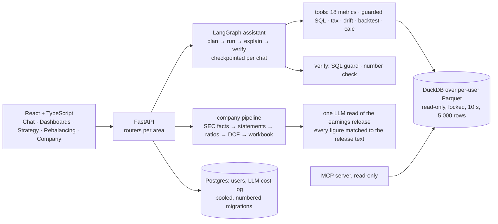

# WealthOS — Technical Report

13 November 2026. Every number below comes from a committed result file, named next to it, and can be re-run with
the command in [docs/eval/README.md](docs/eval/README.md). Nothing here is estimated.

## 1. What WealthOS is

An analyst for your own financial data, with two modes:

- **Personal finance** (Indian retail investor). Upload bank statements (CSV, Excel or PDF), broker tradebooks,
  holdings and mutual-fund CAS statements, then ask in plain English: spending, income, savings rate, portfolio
  value, realised and unrealised gains, old vs new tax regime, drift from a target mix, strategy backtests with
  Indian charges.
- **Company analyst** (US-listed companies). Type a name or ticker; get a five-year Excel workbook built from SEC
  filings: three statements, ratios, a DCF, the latest earnings releases, and accounting checks.

One rule runs through both: **the model plans and explains, code computes, and every number shown is checked.** The
LLM never writes a number a user sees unless that number is found in a query result or a source document.

## 2. Architecture

| Part | Where | What it does |
|---|---|---|
| Assistant | `backend/app/ai/graph.py`, `agent.py` | LangGraph `StateGraph`: one planning call picks one of 15 plan kinds (11 that act, 4 control), code runs it, one call explains ≤40 rows, then every number in the text is verified. State is checkpointed per chat (SQLite per user); seconds per node on every answer; Langfuse tracing when keys are set. |
| Engine | `backend/app/data/engine.py` | In-memory DuckDB per request over the user's Parquet files; external access, extensions and settings locked; 1 GB / 2 threads / 10 s. |
| SQL guard | `backend/app/ai/verify.py` | Exactly one SELECT (writes hidden in CTEs or subqueries now refused); no file, URL or settings functions; every table and column checked against the schema; 5,000-row cap. |
| Number check | `backend/app/ai/verify.py` | Each number in a sentence must match a result value, or a sum, difference or % change within one row or column; lakh/crore aware; currency must match. A failed sentence is replaced by the table. |
| Ingest | `backend/app/data/ingest/` | CSV/Excel header detection; PDF bank statements (HDFC, ICICI, SBI layouts) from word positions; CAS via casparser; running-balance, duplicate and date-gap checks. Column mapping: saved mapping → rules → one LLM call → user confirms, with confidence shown per column. |
| Company mode | `backend/app/company/` | SEC `companyfacts` (newest filing wins per year), five fiscal years, ratios, documented DCF, one earnings-release read, tie-out checks, openpyxl workbook with source comments on every reported cell. |
| Privacy | `backend/app/ai/pii_redaction.py` | Every prompt passes one redactor (PAN, Aadhaar, UPI, IFSC, cards, phones, accounts, emails, GSTIN, PIN codes, labelled names). |
| Cost control | `backend/app/ai/llm_client.py` | Per-user and server daily USD caps; usage logged per user; Groq primary, OpenRouter fallback, any OpenAI-compatible local server (Ollama) by env. |

Code size: 8,506 lines of backend Python, 1,437 lines of frontend TypeScript. Tests: 178 passed, 2 skipped, with no
API keys and no network (21 test modules). CI runs them on every push.

## 3. Does the assistant get the numbers right?

**Golden set:** 34 questions over a synthetic year of bank rows (including one prompt-injection narration), a
Zerodha-style tradebook and holdings. Expected values are computed in plain Python, not by the engine. 25 questions
have numeric answers; 9 test clarifying, refusing advice and small talk.

| | WealthOS, `gpt-oss-120b` | Plain text-to-SQL, same model | WealthOS on local qwen3:8b |
|---|---|---|---|
| Right numbers (25 value questions) | **100%** | 72.0% | 44.0% |
| Right kind of answer (34) | 94.1% | 85.3% | 97.1% |
| Answers marked *trusted* | 92.0% | — | 60.0% |
| Buy/sell advice refused (5) | 100% | 100% | 100% |
| Seconds per question, p50 / p95 | 3.2 / 6.5 | 1.5 / 4.6 | 4.6 / 22.1 |
| Tokens per question | 3,146 | 833 | 2,988 |
| Cost per question | $0.00024 | $0.00006 | $0 |
| Model calls per question | 1.79 | 1.00 | 1.56 |
| Source | `results_openrouter.json` | `results_baseline.json` | `results_local_qwen3_8b.json` |

The two `gpt-oss-120b` columns are served by OpenRouter. The app's default provider is Groq with the same weights;
its free daily token cap (200,000) is smaller than two full runs, so the Groq run is re-recorded separately.

**What this shows**

- **The metrics layer and the number check are worth 28 points of accuracy.** Same model, same questions: letting
  the model write SQL directly gets 72% of numbers right; routing through 18 predefined metrics and checking every
  number gets 100%. The baseline is cheaper and faster (one call, 833 tokens) — the trade is about 4× the tokens for
  no wrong numbers.
- **The check limits a weak model but does not fix it.** On the local 8B model, numbers drop to 44% and the trusted
  badge to 60%. Four of its 14 wrong answers still carry the badge: the model picked the wrong period or filter, so
  the number is computed correctly from a predefined metric but answers a different question. *Trusted* means "a
  defined metric over your data", not "the question was understood". The run also found a bug, now fixed: an
  answer with no data found was marked trusted.
- **The recurring miss** is a vague question (*"What's my return?"*, *"How much did I make?"*): the planner answers
  with a metric instead of asking which one is meant. Details per case in
  [docs/eval/ERROR_ANALYSIS.md](docs/eval/ERROR_ANALYSIS.md).
- **The LangGraph port changed nothing measurable:** replaying all 34 cached runs through the graph gives identical
  answers case by case (`tests/test_evals_smoke.py`).

## 4. Are the guards real?

Labelled sets, all keyless, all in CI (`backend/evals/results_sets.json`, `tests/test_eval_sets.py`).

| Guard | Test set | Result |
|---|---|---|
| SQL guard | 53 attacks (file reads, `COPY`, `ATTACH`, `SET`, stacked statements, comment tricks, writes inside CTEs, unknown tables) + 16 legitimate queries | **100% of attacks blocked, 0 escaped, 0% false blocks.** 2 resource-heavy queries run but are stopped by the 10 s / 5,000-row limits (max 6.5 s). The set found one real hole — a `DELETE` inside a CTE passed the guard — now fixed. |
| Number check | 179 perturbed sentences (exact, rounded, ±0.6 %, ±1 %, ±5 %, ×10, ÷10, lakh read as crore, wrong currency, 50 invented numbers) | **False reject 0.0%, false accept 1.5%.** Invented numbers: 0 of 50 accepted. Known limit: a sum of two other cells stated as the answer is accepted — the check proves a number came from the result, not that the sentence labels it correctly. |
| PII redaction | 55 strings across 11 types + strings that must survive | Recall 84.6% (91.7% excluding the known gap: names inside payment narrations). PAN, UPI, IFSC, email, GSTIN 100%. Must-keep strings survive 92%. |
| Column mapping | 31 header rows modelled on HDFC, ICICI, SBI, Kotak, Axis, Zerodha, Groww, Upstox, CAMS layouts | Rules alone: 83.9% of files fully right, column precision 97.7%, recall 92.1% (in-sample — names were added after a first measurement of 58.1%). Rules + one LLM call: `high` confidence right 100%, `medium` right 95.8%. |
| Deflated Sharpe | Bailey & López de Prado (2014) worked example | **Exact match:** 0.9004 at 100 trials, 0.9505 at 46; benchmark Sharpe 0.1132 (formula) vs 0.1119 (20,000 × 100 Monte-Carlo). |

## 5. Company analyst mode

Five companies, live SEC data (`backend/evals/company_tieouts.json`).

| Check | Years passed |
|---|---|
| Balance sheet balances (assets = liabilities + equity) | 23 / 23 |
| Reported totals agree with summed lines | 23 / 23 |
| Cash-flow sections sum to the net change | 24 / 24 |
| Cash roll-forward (opening + change = closing) | 21 / 23 |
| Gross profit ties | 24 / 24 |
| **All checks** | **115 / 117** |
| Workbook formulas recompute to the Python values | 573 / 573 cells |
| Earnings-release figures found in the release text | 74 / 92 (80.4%) |
| LLM cost for all five companies | $0.0075 |

Tickers: AAPL, MSFT, NVDA, JNJ, GEV. The two failures are GE Vernova's cash roll-forward in 2023 and 2024
(−$582M and +$603M, nearly cancelling), consistent with carve-out cash moved at its April 2024 spin-off from GE —
reported, not hidden. Unverified release figures (mostly table numbers the model rescaled) are flagged red in the
workbook and used nowhere else. The release read ran on `openai/gpt-oss-20b` because the 120B model's free daily
quota was spent. Details: [docs/company_mode.md](docs/company_mode.md).

## 6. Engineering

| Area | State |
|---|---|
| Tests | 178 passed, 2 skipped (LibreOffice recalculation; the Groq golden run until recorded), keyless and offline; CI green on every push |
| Eval in CI | All 34 questions replayed for every recorded run; labelled-set thresholds fail the build on regression |
| API | 59 routes in 6 routers under `backend/app/api/`; every user route checks the token (enforced by a test) |
| Database | One asyncpg pool; numbered SQL migrations recorded in `schema_migrations`, tested on a real Postgres 16 |
| Auth | bcrypt + JWT, refuses to start without a 32-byte secret, lockout after 10 failures, per-route rate limits, export and delete of all user data |
| MCP | Read-only server (metrics, explain a number, tax, drift, backtests), every tool tested, setup in [docs/mcp.md](docs/mcp.md) |
| Docs | [agent graph](docs/agent_graph.md) · [ingest](docs/ingest.md) · [company mode](docs/company_mode.md) · [evals](docs/eval/README.md) · [error analysis](docs/eval/ERROR_ANALYSIS.md) · [MCP](docs/mcp.md) |

## 7. Limits, stated plainly

- **Synthetic data.** The golden set, sample data and labelled sets are synthetic; PDF bank parsing is tested on
  generated PDFs only. Real statements with tight column gaps may need tuning; password-protected bank PDFs are not
  read.
- **Small samples.** 34 golden questions and 31 mapping rows give wide intervals; 97.1% vs 94.1% plan match between
  two runs of the same model is one question.
- **Mapping accuracy is in-sample** (rules were extended after the first measurement).
- **PII redaction is regex-based** and misses names inside payment narrations.
- **Single node.** Rate limits, locks and chat state are per process; the per-user checkpoint file grows until a
  chat is deleted.
- **Company mode:** per-share figures are as filed (not split-adjusted); untagged lines stay blank; no market data is
  fetched (price is an input cell); banks, insurers and REITs are refused.
- **Tax:** FY 2026-27 rules verified against the Finance Bill 2026 memorandum and the Income-tax Act 2025 text as
  passed by the Lok Sabha; buyback and F&O STT changes are not modelled. Always "verify with a CA".
- **Not SEBI-registered.** No buy, sell or hold advice, by design and by test.

## 8. Not done yet

- Hosted deployment (AWS EC2 + Caddy) — needs the owner's AWS access.
- Langfuse trace screenshots — needs Langfuse keys; tracing is wired and tested to be a no-op without them.
- A golden run on Groq itself (same weights as the OpenRouter run; needs a full day's free token budget).
- Screenshots and a demo video.
