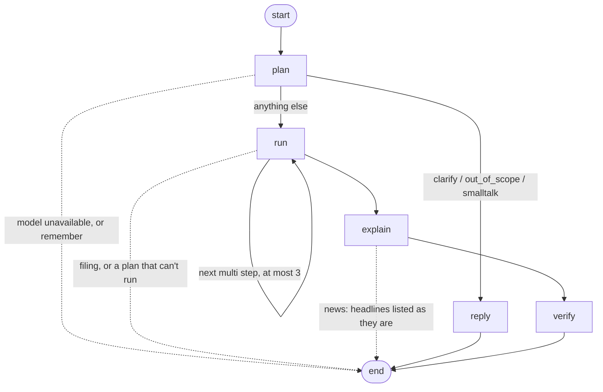

# The assistant graph

The assistant (`backend/app/ai/agent.py: ask`) runs one question through a LangGraph `StateGraph` built in
`backend/app/ai/graph.py`. The prompts, the plan format, the tools and the number check did not change; the graph only
makes the steps and their order explicit, so they can be checkpointed and traced.



| Node | What it does |
|---|---|
| `plan` | One structured model call (`PLANNER`) returns a checked `Plan`. A confirmed meaning (`define`) is saved first; a `remember` plan is saved here and ends the run. |
| `reply` | `clarify`, `out_of_scope` and `smalltalk` need no data: the planner's sentence is shown if it holds no numbers. A clarify answer is an end state; the next question carries the user's choice (`define`). |
| `run` | Runs the plan in code (`agent._run`: engine metrics, guarded SQL, SEC figures, calc, tax, rebalance, prices, backtest, save metric, news). A `multi` plan loops back here once per step (at most 3), tagging rows by step. `filing` questions are answered by `research.py` with page citations and end here. A plan that fails (rejected SQL, missing data) ends with the reason. |
| `explain` | One model call (`EXPLAINER`) over at most 40 result rows. News headlines skip the model and are listed as they are. |
| `verify` | `verify.check_numbers` on the explanation. If any number is not in the rows (or the question), the text is replaced by a plain summary and the table. |

## State and checkpoints

The state is plain data (`graph.State`): the question, the plan as a dict, the rows, provenance, warnings, the draft
text, the final answer and per-node timings. When `/assistant/ask` is called, the chat id is the thread id and each
step's state is saved by LangGraph's SQLite checkpointer in `backend/storage/users/<user>/agent_state.sqlite` (one file per user,
so one user can never read another's thread). Calls without a chat id (evals, tests) run without a
checkpointer. The saved chat (`chats/<id>.json`) is still what the app shows; the checkpoints are for inspecting how
an answer was produced:

```python
from langgraph.checkpoint.sqlite import SqliteSaver
with SqliteSaver.from_conn_string("backend/storage/users/<user>/agent_state.sqlite") as saver:
    for c in saver.list({"configurable": {"thread_id": "<chat id>"}}):
        print(c.metadata["step"], list(c.checkpoint["channel_values"]))
```

Clarify does not use `interrupt`: an interrupt needs a checkpointer on every call, and evals and tests
call `ask` without a chat. The existing round trip (answer with options, then the next question carries `define`)
already resumes in one step and keeps the HTTP contract unchanged.

## Tracing

- Every answer carries `timings`: seconds spent in each node (`plan`, `run`, `explain`, `verify`, or `reply`).
- With `LANGFUSE_PUBLIC_KEY` and `LANGFUSE_SECRET_KEY` set (and `LANGFUSE_HOST` for a self-hosted server), each
  question is sent to Langfuse as one trace named `wealthos-ask` with a span per node. Without the keys no callback
  is attached and nothing is sent.

## Checking a change

`python evals/run.py --offline` replays the recorded model replies (keyed by a hash of the exact prompt), so any change
to a prompt shows up as a cache miss. Re-record with one live run (`python evals/run.py`) only when a prompt changes on
purpose.
