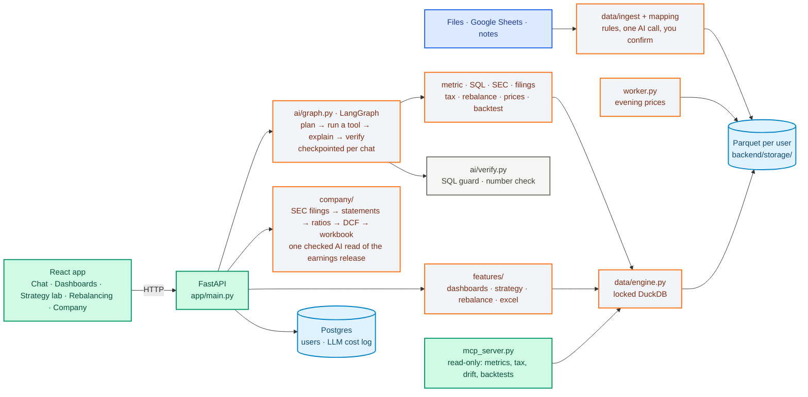

# Architecture

How WealthOS is put together: the request flow, what each part does, and where it lives in the repo. The README
links here; numbers are in [TECHNICAL_REPORT.md](../TECHNICAL_REPORT.md).

## Flow



The AI never writes a number the user sees. It picks a tool; code runs it; every number in the written answer is
matched against the tool's rows, or the sentence is replaced by the table.

## Parts

| Part | Stack | Detail |
|---|---|---|
| **Engine** | DuckDB over Parquet | In-memory connection per request; no external access or extensions; memory/thread limits; locked config; 10 s timeout |
| **Assistant** | LangGraph: one plan, up to 3 tools, one explanation | State saved per chat (SQLite checkpointer per user); seconds per node on every answer; optional Langfuse tracing ([graph](agent_graph.md)). Vague money questions ("what's my return?") are asked back in code before any model call |
| **SQL guard** | DuckDB parser + sqlglot | One SELECT, no file/URL/settings functions, every table and column checked, 5,000-row cap |
| **Number check** | `ai/verify.py` | Every number in a written answer must match a result (or a sum / difference / % change within one row or column); currency must match |
| **LLM** | Groq `openai/gpt-oss-120b`, OpenRouter fallback, any OpenAI-compatible local server | PII redacted on every prompt; per-user and server daily cost caps; tokens, cost and duration logged per call |
| **Ingest** | CSV/Excel/PDF/CAS parsers | HDFC, ICICI and SBI PDF statements; CAS via casparser; column mapping by rules, then one AI call, then the user confirms ([ingest](ingest.md)) |
| **Company mode** | SEC XBRL + openpyxl | Statements, ratios, DCF, a checked release read, quarters, compare, earnings review, rebalance plan ([company mode](company_mode.md)) |
| **Dashboards** | Spec + ops + edit history | Every edit is a checked op; undo/redo; refresh runs no AI; Excel export with a provenance sheet |
| **Excel templates** | openpyxl + headless LibreOffice | Your workbook's Data sheet is filled and recalculated; macros, OFFSET/INDIRECT and Tables refused |
| **Strategy lab** | pandas, vectorized | Decide at the close, fill at the next open; STT, stamp duty, exchange and SEBI fees, GST; deflated Sharpe |
| **Python strategies** | Separate process | Code checked first (pandas / numpy / math only), 30 s limit, output checked; off in production unless enabled |
| **Tax** | Per-FY rule tables | Old vs new regime, capital gains from your tradebook; "verify with a CA" |
| **Auth** | bcrypt + JWT | 7-day sessions; refuses to start without a 32+ byte secret; login lockout; rate limits; export or delete all your data |
| **MCP** | FastMCP, read-only | Metrics, explain a number, tax, drift, backtests ([MCP](mcp.md)) |

## Repo layout

```
backend/
  app/
    main.py          the HTTP API: app, middleware, startup, sign-in checks
    api/             the routes, one router per area (account, sources, assistant, dashboards, strategy, company)
    worker.py        background job: evening price refresh
    mcp_server.py    read-only MCP server
    ai/              the assistant: LangGraph graph, LLM client, PII redaction, SQL + number checks, tools, filing search
    company/         company analyst: SEC facts, statements, quarters, ratios, valuation, release reader, compare, review
    core/            settings, rate limits, account export / delete, workspaces, migrations runner
    data/            DuckDB engine, metrics.yaml, file parsers (ingest/, finx/), column mapping, prices, time periods
    features/        dashboards, templates, Excel templates, reports, strategy lab + Python sandbox, rebalancing, tax
  migrations/        numbered Postgres SQL files, applied once each at API startup
  tests/  evals/  scripts/
frontend/src/        App (top bar) · Chat · Upload · Dashboards · Strategy · Rebalance · Company · CompanyLoop
docker-compose.yml   web, API, price worker, Postgres
```

User data lives in `backend/storage/` (never committed). Postgres holds only accounts and the LLM cost log.

## Settings

Every setting is listed with its default in [`.env.example`](../.env.example). The required ones are
`GROQ_API_KEY`, `WEALTHOS_JWT_SECRET` (32+ bytes) and `WEALTHOS_DB_URL`; `SEC_USER_AGENT` is needed for company mode.
`WEALTHOS_ENV` unset means production, which turns off NSE downloads, Python strategy uploads and free fallback models.
